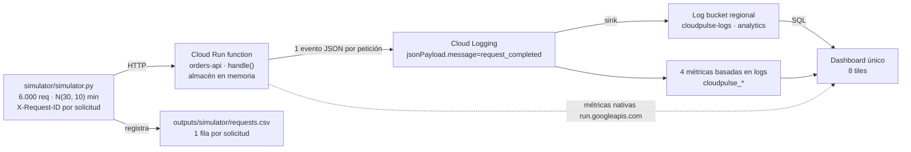

# CloudPulse

Laboratorio de observabilidad serverless en Google Cloud: una API HTTP de pedidos
desplegada como Cloud Run function, un simulador que le lanza 6.000 solicitudes
distribuidas en 60 minutos según una normal, y un único dashboard de Cloud
Monitoring que reúne métricas nativas, métricas basadas en logs, SQL de Log
Analytics y un panel de logs.

> **Estado actual: no desplegado.** No se ha ejecutado `terraform apply`, no se ha
> habilitado ninguna API de cómputo, no existe ningún recurso en
> `cloudpulse-lab-2026` y no se ha lanzado la corrida de 6.000 solicitudes.
> `infra/main.tf` está vacío: la infraestructura de cómputo (servicios, cuenta de
> servicio, bucket de código y la propia función) todavía no está escrita.
> El estado verificado, con evidencia, está en
> [`outputs/reports/predeployment-review.md`](outputs/reports/predeployment-review.md).

## 1. Arquitectura



### Componentes

| Componente | Ruta | Qué hace |
| --- | --- | --- |
| API de pedidos | `backend/main.py` | Tres operaciones HTTP sobre un almacén en memoria. Emite exactamente un evento JSON estructurado por petición. |
| Simulador | `simulator/simulator.py` + `simulator/config.json` | Construye un plan determinista y lo ejecuta de forma concurrente, escribiendo una fila de CSV por solicitud. |
| Infraestructura | `infra/*.tf` | Bucket de logs con Log Analytics, sink, vista, cuatro métricas basadas en logs y el dashboard. **Falta el cómputo.** |
| Pruebas | `tests/` | 226 pruebas que ejercitan la API real vía Functions Framework y el simulador completo. |
| Documentación | `docs/` | Guía de instalación, arquitectura, observabilidad y consultas SQL. |

### Contrato de la API

| Operación | Ruta | Éxito | Errores |
| --- | --- | --- | --- |
| Crear | `POST /orders` | `201` | `400` payload inválido |
| Consultar | `GET /orders/{id}` | `200` | `404` pedido inexistente |
| Cancelar | `POST /orders/{id}/cancel` | `200` | `404` inexistente · `409` ya cancelado |

Cualquier otra ruta responde `404`. `FAILURE_RATE` inyecta `500` de forma
probabilística y `EXTRA_LATENCY_MS` añade retardo artificial; las dos se leen en
cada petición, así que se pueden retocar sin volver a desplegar.

Cada respuesta devuelve la cabecera `X-Request-ID` (la del cliente, saneada, o
una nueva) y el mismo valor viaja en el evento de log, que es lo que permite
unir `requests.csv` con Cloud Logging.

## 2. Requisitos

| Herramienta | Versión verificada | Para qué |
| --- | --- | --- |
| Python | 3.13 (`.python-version`) | API y simulador; coincide con el runtime `python313`. |
| uv | cualquiera reciente | Entorno virtual y dependencias. |
| Terraform | 1.16.6 (requiere `>= 1.9`) | Infraestructura. |
| Google Cloud CLI | cualquiera reciente | Autenticación, validaciones y despliegue. |
| GNU Make | cualquiera | Atajos de desarrollo. |
| terraform provider google | `~> 8.7` (8.7.0 en el lock) | Recursos de GCP. |

Instalación detallada de Terraform, gcloud y la configuración del proyecto de
Google Cloud: [`docs/guide.md`](docs/guide.md) §3 a §5.

```bash
make install        # uv sync + extensiones de VS Code
```

## 3. Comandos de desarrollo

```bash
make help           # lista los objetivos disponibles
make test           # pytest sobre tests/
make lint           # ruff check backend simulator tests
make format         # ruff format
make check          # lint + test + infra-fmt
make infra-fmt      # terraform fmt -check -recursive
make infra-validate # terraform validate (requiere init previo)
```

`make infra-validate` necesita que `infra/` esté inicializado:

```bash
terraform -chdir=infra init -backend=false
```

## 4. Pruebas locales

Levantar la función con Functions Framework:

```bash
uv run functions-framework --target handle --source backend/main.py --port 8091
```

Inspeccionar el plan del simulador sin enviar nada:

```bash
uv run python simulator/simulator.py --dry-run
```

Ensayo pequeño contra la función local:

```bash
uv run python simulator/simulator.py --quick \
  --target-url http://127.0.0.1:8091 \
  --output outputs/simulator/requests_quick.csv
```

Procedimiento completo, con los resultados medidos:
[`docs/guide.md`](docs/guide.md) §7.

## 5. Infraestructura

`infra/` declara hoy ocho recursos, todos de observabilidad:

```bash
terraform -chdir=infra init -backend=false
terraform -chdir=infra validate
terraform -chdir=infra plan      # lectura; no modifica nada
```

Variables y valores del laboratorio: `infra/variables.tf` y
`infra/terraform.tfvars` (este último está en `.gitignore`).
Detalle de cada recurso y del dashboard: [`docs/observability.md`](docs/observability.md).

**El despliegue todavía no es posible.** `infra/main.tf` está vacío, así que
faltan los `google_project_service`, la cuenta de servicio, el bucket del código
fuente y la propia Cloud Run function. El procedimiento de despliegue previsto
—y los requisitos que deben cumplirse antes— está en
[`docs/guide.md`](docs/guide.md) §9.

## 6. Costos

El proyecto se opera con un presupuesto de referencia de **US$5/mes con alertas**.

> Un presupuesto con alertas **no es un límite de gasto**: Google Cloud no
> suspende los servicios al alcanzarlo y las notificaciones pueden llegar con
> retraso. Es posible superar los US$5.

Riesgos y mitigaciones concretas:
[`outputs/reports/predeployment-review.md`](outputs/reports/predeployment-review.md) §7.

## 7. Limpieza

`terraform destroy` elimina los recursos que Terraform creó y **solo debe
ejecutarse con aprobación explícita**. Hay dos consecuencias que no se deshacen:

- Un log bucket actualizado a Observability Analytics **no puede degradarse**
  para quitar esa capacidad; solo se puede borrar el bucket.
- Borrar el bucket de logs borra los datos de la corrida, que son el resultado
  del laboratorio. Exporta `requests.csv` y las consultas SQL antes.

Procedimiento: [`docs/guide.md`](docs/guide.md) §11.

## 8. Documentación

| Documento | Contenido |
| --- | --- |
| [`docs/guide.md`](docs/guide.md) | Instalación, configuración de GCP, comandos, pruebas locales, Terraform, despliegue y limpieza. |
| [`docs/architecture.md`](docs/architecture.md) | Diagramas del camino de una petición, estados del pedido y la carrera que obliga al lock. |
| [`docs/observability.md`](docs/observability.md) | Métricas nativas y basadas en logs, SQL, dashboard y procedimiento manual equivalente. |
| [`docs/log-analytics-queries.sql`](docs/log-analytics-queries.sql) | Siete consultas de Log Analytics, con los avisos sobre el tiempo observado. |
| [`AGENTS.md`](AGENTS.md) | Responsabilidades y restricciones para el desarrollo asistido por IA. |
| [`outputs/reports/predeployment-review.md`](outputs/reports/predeployment-review.md) | Auditoría previa al despliegue con el veredicto actual. |
