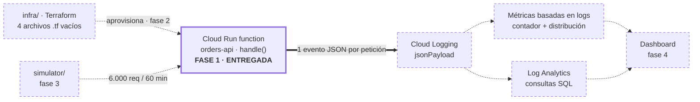
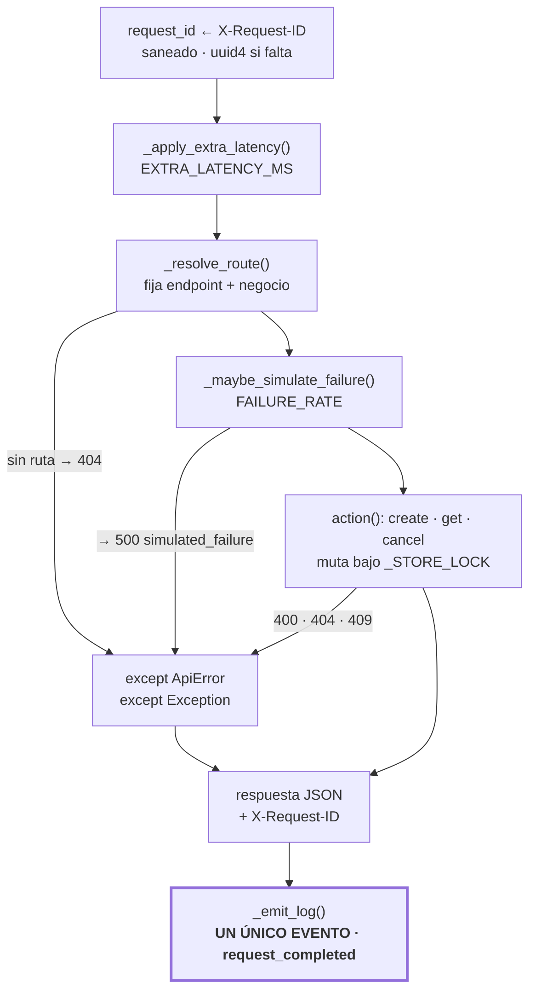
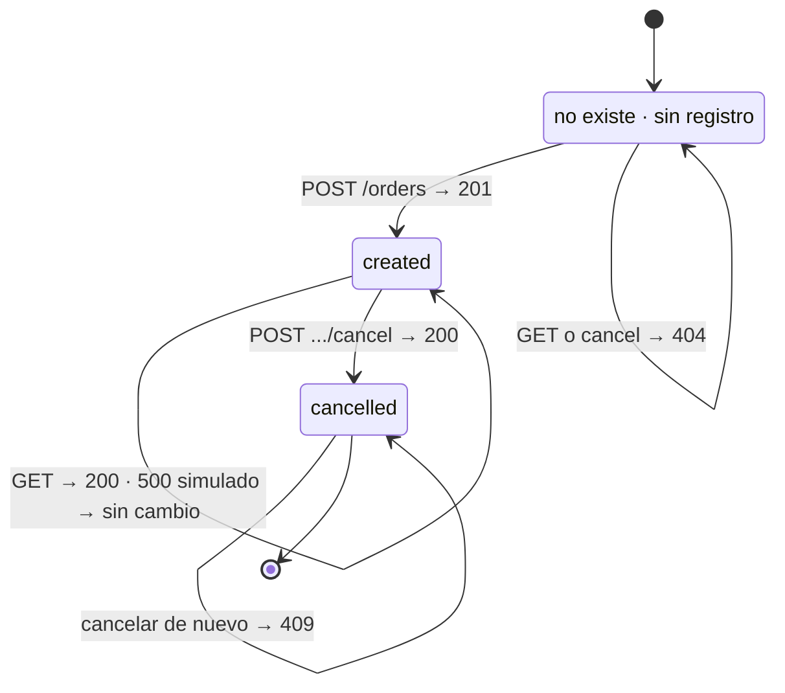
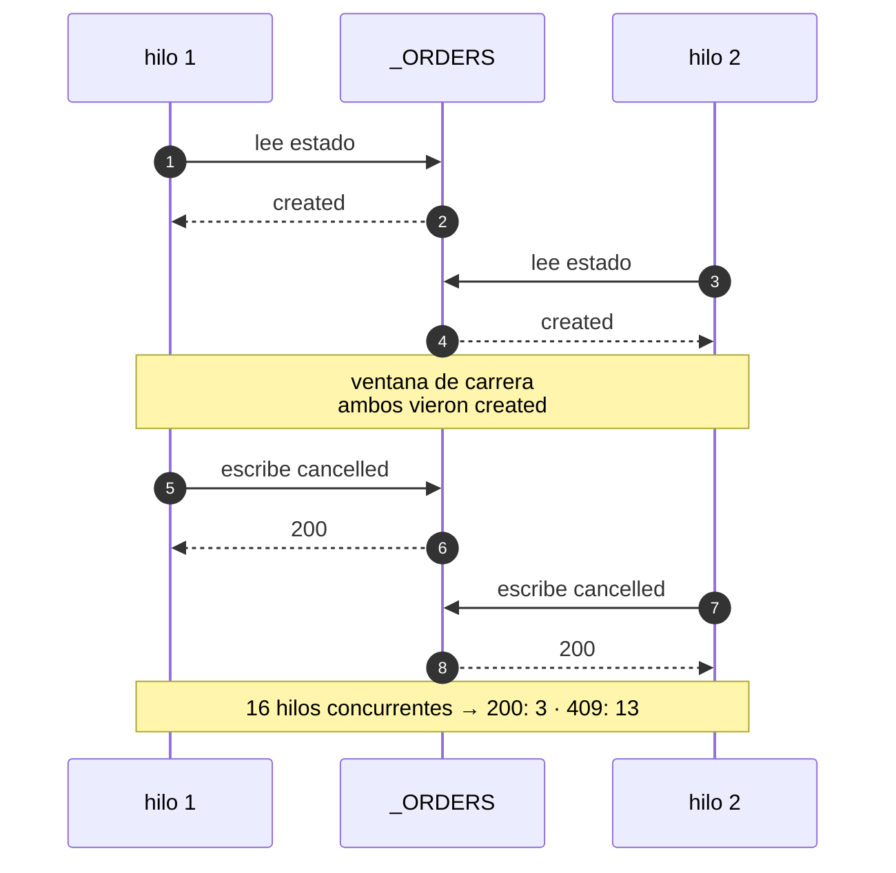
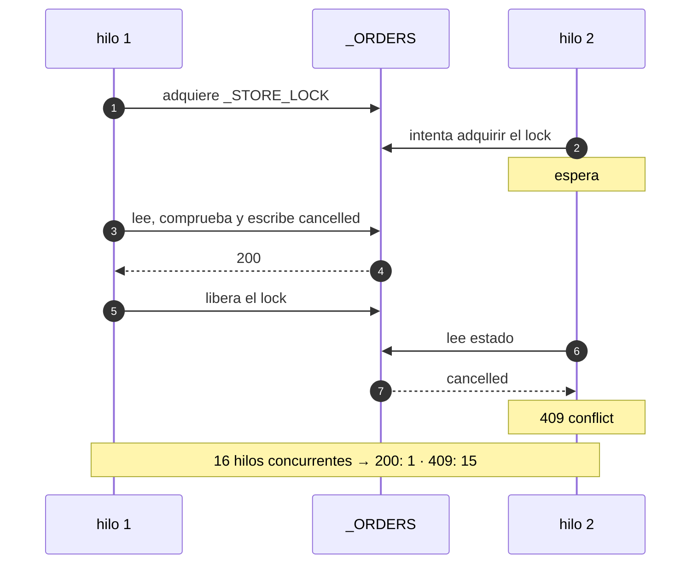
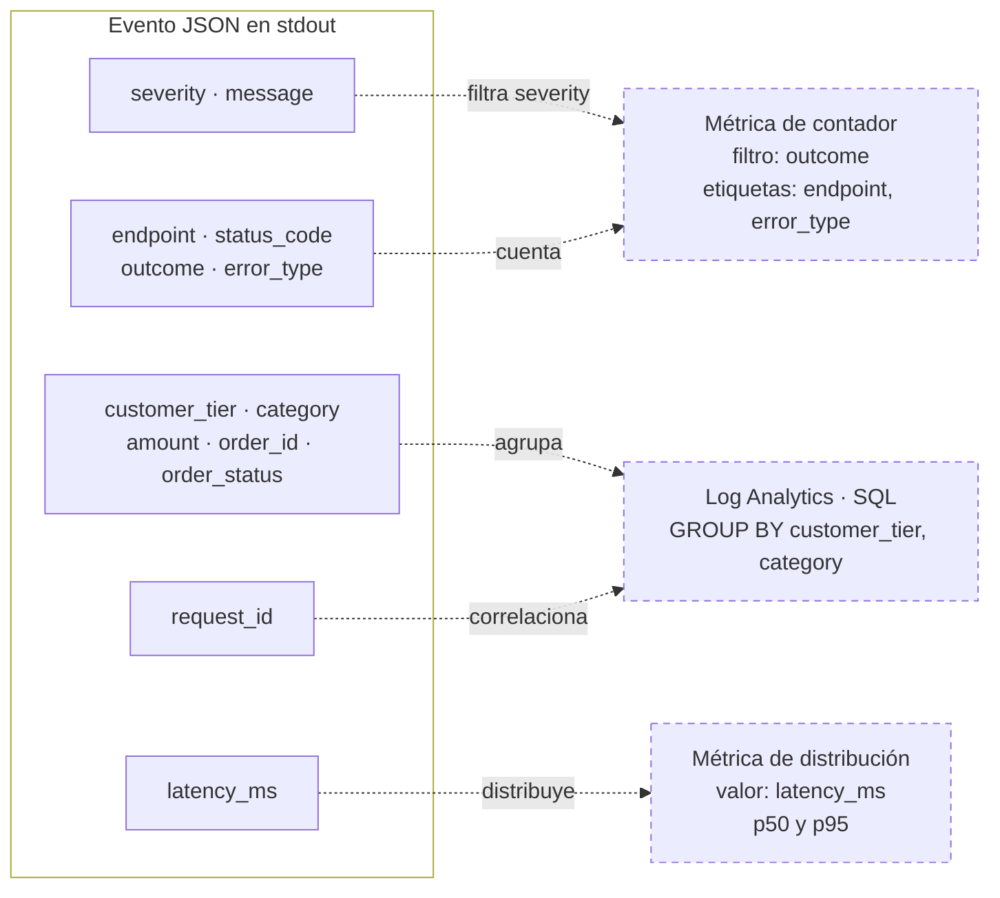

# CloudPulse — Arquitectura y diseño de la fase 1

Diagramas del avance real del proyecto. La fase 1 entregó una sola pieza del laboratorio —la función HTTP de pedidos— y, con ella, el contrato del evento de log del que dependen las métricas, las consultas SQL y el dashboard.

> **Nota de alcance (actualizada en la auditoría previa al despliegue):** este
> documento describe la **fase 1** y sus cifras son las de aquel momento (86
> pruebas, `infra/` vacío). A día de hoy el repositorio tiene **226 pruebas** y
> `infra/` declara ocho recursos de observabilidad, aunque `infra/main.tf` sigue
> vacío. Las figuras 2 a 5 siguen siendo exactas: describen `backend/main.py`,
> que no ha cambiado de contrato. Para el estado actual ver `README.md` y
> `outputs/reports/predeployment-review.md`.

Cada figura muestra un mecanismo que la prosa no deja ver: dónde encaja lo construido, en qué orden ocurren las cosas dentro de una petición, qué transiciones producen los códigos de error, por qué existe el lock y qué campo alimenta a qué consumidor.

| Dato | Valor |
| --- | --- |
| `backend/main.py` | 433 líneas |
| Pruebas | 86 / 86 |
| Ciclos TDD | 4 |
| Runtime objetivo | `python313` |
| Operaciones | 3 |

## 1. Dónde encaja lo construido

El laboratorio completo es una cadena: el simulador genera tráfico, la función responde y emite logs, Cloud Logging los ingiere, las métricas basadas en logs y Log Analytics los agregan, y el dashboard los muestra. La fase 1 construyó **un solo eslabón**.



**Figura 1.** El trazo continuo es lo construido; todo lo punteado está pendiente. Lo que está punteado depende del formato del evento JSON que ya quedó fijado, y las métricas basadas en logs solo ven registros ingeridos *después* de crearse — por eso deben existir antes de lanzar las 6.000 peticiones.

## 2. El camino de una petición

Todo el comportamiento observable de la API está en el orden de estos pasos. La latencia artificial se aplica antes de enrutar (para que también retrase los errores), el fallo simulado se inyecta **después de resolver la ruta y antes de mutar estado**, y los dos `except` desembocan en el mismo punto de salida que el camino feliz.



**Figura 2.** Las tres salidas de error y el camino feliz convergen en el mismo `_emit_log()`: es lo que garantiza exactamente un evento por petición, incluso cuando el fallo es un bug nuestro.

La posición del fallo simulado compra tres propiedades a la vez:

- La tasa de 500 observada no depende de si el payload era válido.
- Ningún 500 deja un pedido a medio cancelar.
- El evento conserva `endpoint` y los atributos de negocio, así que los errores se pueden desglosar por operación y por segmento en el dashboard.

`latency_ms` se mide desde el inicio de `handle` hasta `_emit_log`, de modo que incluye la latencia artificial pero no el cold start ni la red.

## 3. Estados de un pedido

El dominio es deliberadamente pequeño: dos estados reales y un pseudo-estado para lo que no existe. Los códigos 404 y 409 del laboratorio salen directamente de las transiciones imposibles.



**Figura 3.** `cancelled` es terminal: la segunda cancelación es la transición imposible que produce el 409. El 500 simulado es la única flecha que devuelve al pedido al mismo estado, verificado con una prueba que cancela con `FAILURE_RATE=1` y después comprueba que sigue en `created`.

## 4. La carrera que obliga al lock

`cancel` es un read-modify-write: leer el estado, comprobar que no esté cancelado, escribir. Sin proteger esa secuencia, dos hilos pueden leer `created` antes de que cualquiera escriba, y los dos creen haber cancelado.



**Figura 4a.** Sin lock. Cifras medidas sobre una copia del módulo con el lock quitado y la ventana de carrera ensanchada: el pedido se cancela tres veces.



**Figura 4b.** Con `_STORE_LOCK`. Mantener el lock sobre la comprobación *y* la escritura es lo que convierte quince cancelaciones perdedoras en quince 409.

## 5. Un evento, tres consumidores

Cada campo del evento existe porque algo aguas abajo lo va a consumir. Los campos de dimensión son de baja cardinalidad a propósito: `endpoint` guarda la plantilla de ruta (`GET /orders/{id}`) y nunca el id concreto, y los atributos de negocio solo se registran si el valor pertenece al esquema — un `customer_tier` arbitrario enviado por un cliente recibe 400 y no llega a convertirse en etiqueta de métrica.



**Figura 5.** El evento es el contrato de la fase 2: sus campos ya están elegidos para que las métricas basadas en logs y las consultas SQL se puedan definir sin volver a tocar el backend. Los tres consumidores aparecen punteados porque todavía no existen.

### Eventos reales capturados del servidor local

```json
{"severity": "INFO", "message": "request_completed", "request_id": "sim-000001", "endpoint": "POST /orders", "status_code": 201, "outcome": "success", "error_type": "none", "latency_ms": 25.92, "customer_tier": "premium", "category": "electronics", "amount": 149.99, "order_id": "ord_f5bcfb373ea340da99b8616b7cb0bcc1", "order_status": "created"}
{"severity": "ERROR", "message": "request_completed", "request_id": "sim-000500", "endpoint": "POST /orders", "status_code": 500, "outcome": "server_error", "error_type": "simulated_failure", "latency_ms": 0.695, "customer_tier": "standard", "category": "grocery", "amount": 42, "order_id": null, "order_status": null}
```

En el evento del 500 los atributos de negocio sobreviven, pero `order_id` es `null`: no se guardó nada.

## 6. Cómo se construyó

Cuatro ciclos red-green. La tercera columna es el fallo observado antes de escribir cada implementación: es la evidencia de que la prueba podía fallar.

| Ciclo | Alcance | Fallo observado en rojo | Verde |
| --- | --- | --- | --- |
| 1 | CRUD y validación | `MissingTargetException: expected a function named 'handle'` | 32 / 32 |
| 2 | Logging estructurado | `IndexError` (sin eventos) · `BadRequestKeyError` (sin cabecera) | 51 / 51 |
| 3 | Fallos y latencia | `assert 201 == 500` · `assert 0.65 >= 150` · `no attribute '_resolve_route'` | 83 / 83 |
| 4 | Concurrencia | módulo mutado sin lock → `200: 3 · 409: 13` | 86 / 86 |

## 7. Lo que estas figuras no arreglan

- **El almacén es por instancia.** Nada en la figura 1 comparte estado entre instancias de Cloud Run: un `GET` o un `cancel` que caiga en una instancia distinta a la del `POST` devuelve un 404 legítimo. Con 6.000 peticiones concurrentes eso va a producir 404 de fondo que no son bugs — hay que decidir antes de la fase 3 si se fija una sola instancia o si se miden esos 404 como parte del experimento.
- **Los 500 no son reproducibles entre corridas.** `random()` va sin semilla; el comportamiento solo es determinista en los extremos 0 y 1, que es lo que fijan las pruebas.
- **`latency_ms` se mide dentro de la función.** No incluye cold start ni red, así que será sistemáticamente menor que la latencia que reporte Cloud Monitoring.
- **No hay contrato OpenAPI.** Las rutas y los códigos están fijados por pruebas, no por una especificación legible por máquina.

## 8. Siguiente fase

Terraform antes que el simulador: las métricas basadas en logs solo ven registros ingeridos después de crearse, así que lanzar las 6.000 peticiones primero significaría repetir —y pagar— la corrida.

Faltan por habilitar `run`, `cloudfunctions`, `cloudbuild`, `artifactregistry` e `iam`. Deben declararse como `google_project_service` en Terraform, con aprobación explícita antes del `apply`.
