# CloudPulse — Informe final del laboratorio

**API serverless observable en Google Cloud Platform**

| Dato | Valor |
| --- | --- |
| Proyecto GCP | `cloudpulse-lab-2026` · región `us-central1` |
| Servicio | `orders-api` (Cloud Run functions, 2.ª generación) |
| Corrida oficial | `cc4f0755` · 2026-10-16T10:56:57Z → 11:55:18Z |
| Solicitudes | 6.000 |
| Fecha del informe | 2026-10-16 |

**Nota metodológica.** Todas las cifras de este documento proceden de
`outputs/simulator/requests.csv`, de consultas a Cloud Logging, de la API de
Cloud Monitoring o de las diez capturas de `evidence/`. Cuando una comprobación
no pudo realizarse, se indica explícitamente en lugar de estimarla. Las
diferencias entre el análisis automatizado y la ejecución manual de las
consultas se documentan en la sección 7 sin excepción.

---

## 1. Resumen ejecutivo

CloudPulse es un laboratorio de observabilidad cuyo objetivo es construir una
API HTTP serverless en Google Cloud, someterla a una carga controlada de 6.000
solicitudes planificadas sobre una ventana de 60 minutos y analizar su
comportamiento
—tráfico, latencia, errores y escalamiento— desde un único dashboard que
combina métricas nativas, métricas basadas en logs y consultas SQL sobre Log
Analytics.

La arquitectura consta de tres piezas: un **simulador** en Python que genera el
tráfico según una distribución normal; una **función HTTP** desplegada en Cloud
Run con runtime `python313`, que expone tres operaciones de pedidos y emite un
evento JSON estructurado por cada solicitud; y una **capa de observabilidad**
declarada en Terraform —bucket regional con Log Analytics, sink, vista, cuatro
métricas basadas en logs y un dashboard de ocho paneles—.

La corrida oficial se completó con **6.000 de 6.000 solicitudes**, cero errores
de transporte, cero timeouts, cero fallos de autenticación y cero excepciones no
controladas en el backend. Las 6.000 filas del CSV se correlacionan una a una
con los 6.000 eventos `request_completed` registrados en Cloud Logging, con
idénticos códigos de respuesta en ambos lados. La función permaneció **privada**
durante todo el experimento: el tráfico se autenticó con tokens de identidad
renovados automáticamente, sin conceder acceso a `allUsers`.

Dos desviaciones, ambas medidas y ninguna de ellas invalidante, se documentan en
detalle: la ejecución observada duró **58 min 21 s** frente a los 60 minutos
planificados —por un desvío de reloj del 2,767 % en el entorno WSL2, que
reescala el eje temporal sin deformar la distribución—, y el escenario
`double_errors` midió
**1,83×** en lugar de 2,00× por ruido de muestreo (−0,84σ). Una limitación de
diseño, aceptada conscientemente, impide demostrar el escalamiento horizontal:
`max_instances = 1`.

## 2. Objetivos

### 2.1. Objetivo general

Desarrollar, desplegar y observar una API serverless en Google Cloud Platform,
generando tráfico sintético con una distribución estadística conocida y
analizando su comportamiento mediante un dashboard unificado de observabilidad.

### 2.2. Objetivos específicos

| # | Objetivo | Estado |
| --- | --- | --- |
| O1 | Implementar una API con al menos tres operaciones y los códigos 400, 404, 409 y 500 | ✅ Cumplido |
| O2 | Emitir registros estructurados en JSON con atributos de negocio y latencia | ✅ Cumplido |
| O3 | Propagar un identificador de correlación `X-Request-ID` extremo a extremo | ✅ Cumplido, 6.000/6.000 |
| O4 | Aprovisionar la infraestructura con Terraform e IAM de mínimo privilegio | ✅ Cumplido |
| O5a | Generar 6.000 solicitudes según `N(30, 10)` truncada a `[0, 60]` | ✅ Cumplido, 6.000/6.000 |
| O5b | Que la ejecución se extienda sobre una ventana de 60 minutos | ⚠️ **Cumplimiento parcial**: planificada en 60 min, **ejecutada en 58 min 21 s** (§9.5) |
| O6 | Inyectar ~8 % de errores intencionales del cliente y un escenario temporal | ✅ Cumplido, 8,20 % medido |
| O7 | Distinguir errores intencionales del cliente de fallos internos del servidor | ✅ Cumplido |
| O8 | Definir métricas basadas en logs **antes** de generar tráfico | ✅ Cumplido y verificado en preflight |
| O9 | Analizar los registros con SQL de Log Analytics | ✅ Cumplido, 8 consultas ejecutadas (§7) |
| O10 | Consolidar todo en un único dashboard de Cloud Monitoring | ✅ Cumplido, 8 paneles (§6) |
| O11 | Observar el escalamiento horizontal | ⚠️ **No demostrable** con `max_instances = 1` (§6.3) |

La planificación empleó una ventana de 60 minutos —los 6.000 instantes se
extraen de `N(30, 10)` y se truncan a `[0, 60]`, como confirma el plan— pero la
**ejecución observada fue más corta: 58 minutos y 21 segundos**, por el desvío
de reloj del 2,767 % que documenta §9.5. Por eso el requisito de duración se
clasifica como cumplimiento parcial, mientras que los de volumen, distribución,
escenario de errores y trazabilidad se cumplen sin reservas.

## 3. Arquitectura implementada

### 3.1. Visión general

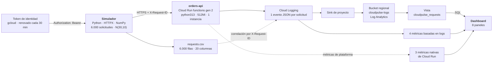

### 3.2. Simulador (Python, HTTPX, NumPy)

`simulator/simulator.py` convierte `simulator/config.json` en un **plan
determinista** y lo ejecuta:

- **NumPy** extrae los 6.000 instantes de llegada de `N(mu=30, sigma=10)` en
  minutos, los trunca al intervalo `[0, 60]` y los ordena. La semilla 42 hace el
  plan reproducible: el mismo fichero de configuración genera siempre el mismo
  experimento.
- **HTTPX con `asyncio`** envía cada solicitud en su instante programado sin
  esperar a que termine la anterior: una tarea por solicitud sobre un único
  `AsyncClient` cuyo pool se limita a 50 conexiones, de modo que 6.000
  solicitudes nunca se convierten en 6.000 sockets.
- Cada solicitud lleva una cabecera `X-Request-ID` única y escribe una fila en
  `requests.csv` en cuanto termina, descargada a disco inmediatamente: una
  corrida interrumpida conserva todo lo ya medido.

### 3.3. Función HTTP (Cloud Run functions, Python 3.13)

`backend/main.py` expone tres operaciones sobre un almacén en memoria:

| Operación | Ruta | Códigos |
| --- | --- | --- |
| Crear pedido | `POST /orders` | 201, 400 |
| Consultar pedido | `GET /orders/{id}` | 200, 404 |
| Cancelar pedido | `POST /orders/{id}/cancel` | 200, 404, 409 |

Cada solicitud produce **exactamente un** evento JSON en stdout
(`message="request_completed"`) con el identificador de correlación, la ruta
plantilla, el código, el `outcome`, el `error_type`, la latencia interna y los
atributos de negocio. Dos variables de entorno modelan el experimento:
`FAILURE_RATE` (probabilidad de responder 500) y `EXTRA_LATENCY_MS`.

### 3.4. Terraform e IAM de mínimo privilegio

`infra/` declara 27 recursos. En el plano de identidades:

- **Dos cuentas de servicio dedicadas**: `orders-api-run` (ejecución) y
  `orders-api-build` (compilación). La función **no** usa la cuenta por defecto
  de Compute Engine, que arrastra `roles/editor` sobre todo el proyecto.
- La cuenta de ejecución tiene **un solo rol**: `roles/logging.logWriter`. Es lo
  único que necesita, porque la API no accede a ningún otro servicio.
- La cuenta de compilación tiene `logging.logWriter` y `artifactregistry.writer`
  a nivel de proyecto, y la lectura del código acotada **a dos buckets
  concretos**, no al proyecto.
- Ningún binding usa roles básicos (`owner`, `editor`, `viewer`).

### 3.5. Observabilidad

| Componente | Detalle |
| --- | --- |
| Cloud Logging | El evento JSON se ingiere con `severity` elevado a nivel de entrada |
| Bucket regional | `cloudpulse-logs` en `us-central1`, con Observability Analytics habilitado |
| Sink | Enruta los logs del servicio al bucket; es aditivo, `_Default` sigue recibiéndolos |
| Vista | `cloudpulse_requests`, filtro `resource.type="cloud_run_revision"` |
| Métricas basadas en logs | `requests_by_outcome`, `client_errors`, `server_errors`, `order_amount` (distribución) |
| Métricas nativas | `request_count`, `request_latencies`, `container/instance_count` |
| Dashboard | Un recurso, ocho paneles (§6) |

### 3.6. Correlación mediante `X-Request-ID`

El simulador genera `sim-<run_id>-<índice>`, la función lo sanea y lo devuelve
en la respuesta, y lo incluye en el evento de log. Esto permite unir las tres
superficies: la fila del CSV (que conoce el **plan**: `scheduled_min`,
`intended_event`), el evento de Cloud Logging (que conoce lo que **ocurrió**
dentro de la función) y la consulta SQL que recupera cualquiera de los dos.

## 4. Metodología

### 4.1. Diseño del experimento

| Parámetro | Valor | Fuente |
| --- | --- | --- |
| Solicitudes | 6.000 | `n_requests` |
| Distribución de llegadas | `N(mu=30, sigma=10)` minutos, truncada a `[0, 60]` | `mu_min`, `sigma_min` |
| Semilla | 42 | `seed` |
| Errores intencionales | 8 % | `invalid_share` |
| Escenario | `double_errors` en `[35, 45)` sobre `electronics` | `scenarios` |
| Mezcla de operaciones | crear 50 % · consultar 30 % · cancelar 20 % | `operation_mix` |
| Fallo inyectado en el backend | 2 % | `FAILURE_RATE` |
| Timeout de cliente | 10 s | `timeout_s` |
| Pool de conexiones | 50 | `max_connections` |
| Renovación del token | cada 1.800 s | `token_refresh_s` |

### 4.2. Errores intencionales

El 8 % de solicitudes defectuosas se reparte en las tres familias que exige el
laboratorio, y nunca se confunden con defectos del servidor:

| Familia | Mecanismo | Código | Planificadas |
| --- | --- | --- | --- |
| Payload incorrecto | Seis variantes, una por regla del esquema | 400 | 259 |
| Identificador inexistente | `ord_missing_NNNNNN`, inventado por el simulador | 404 | 188 |
| Secuencia imposible | Cancelar un pedido ya cancelado | 409 | 49 |

El escenario `double_errors` duplica la **probabilidad** de error intencional
—de 0,08 a 0,16— para las solicitudes del segmento `electronics` cuyo instante
cae en `[35, 45)`.

### 4.3. Autenticación con tokens renovables

La función es privada: responde `403` a cualquier llamada sin identidad. Como la
corrida dura 60 minutos y un token de identidad vive aproximadamente una hora,
el simulador **mina y renueva el token por su cuenta**:

- `gcloud auth print-identity-token` se ejecuta al arrancar y cada
  `token_refresh_s` (1.800 s), de modo que ningún token se usa más allá de la
  mitad de su vida;
- la credencial llega por stdout del subproceso y vive **solo en memoria**:
  nunca es argumento de proceso, nunca entra en la configuración, nunca aparece
  en el CSV ni en los resúmenes;
- un fallo de renovación se reporta y la corrida continúa con el token vigente,
  porque una corrida de 60 minutos no puede abortarse por un fallo transitorio.

**No se modificó IAM ni se concedió acceso público en ningún momento.**

### 4.4. Ejecución concurrente

El despachador recorre el plan, duerme hasta el siguiente instante programado y
lanza cada solicitud como una tarea independiente. La simultaneidad la acota el
pool de conexiones del cliente, no el despachador, de modo que una respuesta
lenta no retrasa el calendario del resto.

### 4.5. Verificación previa

Antes de la corrida se ejecutó `scripts/preflight.sh`, que comprobó la
configuración, la calidad local (265 pruebas automatizadas en verde), la
identidad y la facturación, el estado de la función, la **ausencia de `allUsers`
en la política IAM**, la autenticación mediante una petición de sondeo y —lo más
importante— que **las cuatro métricas basadas en logs ya existían**, porque una
métrica de este tipo no cuenta entradas anteriores a su creación.

## 5. Resultados experimentales

### 5.1. Indicadores principales

| Indicador | Resultado |
| --- | ---: |
| Solicitudes enviadas | 6.000 |
| HTTP 2xx | 5.378 |
| HTTP 4xx | 492 |
| HTTP 5xx | 130 |
| Errores de transporte | 0 |
| Respuestas inesperadas | 0 |
| Latencia de cliente p50 | 81,2 ms |
| Latencia de cliente p95 | 192,8 ms |
| Media planificada de llegadas | 29,918 min |
| Desviación planificada | 10,004 min |
| Duración observada | 58 min 21 s |

### 5.2. Desglose por código de respuesta

| Código | Solicitudes | Origen |
| --- | ---: | --- |
| `200` | 2.716 | consultas y cancelaciones válidas |
| `201` | 2.662 | pedidos creados |
| `400` | 253 | payload inválido **intencional** |
| `404` | 192 | identificador inexistente **intencional** (+ 5 degradaciones del pool) |
| `409` | 47 | secuencia imposible **intencional** |
| `500` | 130 | **fallo inyectado por el backend**, no defecto |

La proporción de 4xx fue del **8,20 %** frente al 8 % configurado, y la de 5xx
del **2,17 %** frente al 2 % de `FAILURE_RATE` (+0,6σ sobre 6.000 ensayos). El
clasificador del simulador registró `as_expected` 5.870 y `server_error` 130,
**sin una sola respuesta `unexpected`**.

De los 130 fallos del servidor, 121 recayeron sobre solicitudes válidas y 9
sobre solicitudes que ya iban rotas a propósito: el backend inyecta el fallo
antes de validar, y el registro los separa igualmente porque **un 5xx nunca se
contabiliza como error intencional del cliente**.

### 5.3. Latencia: tres puntos de medición distintos

| Punto de medición | p50 | p95 | Qué incluye |
| --- | ---: | ---: | --- |
| **Cliente** (`requests.csv`) | **81,2 ms** | **192,8 ms** | internet, TLS, proxy de Cloud Run y función |
| **Cloud Run** (`request_latencies`) | 5,06 ms | 9,62 ms | el tramo dentro de la plataforma |
| **Función** (`json_payload.latency_ms`) | 0,187 ms | 0,376 ms | solo el interior de `handle` |

La sobrecarga de red y plataforma es de **81,0 ms en la mediana**: el 99,8 % de
lo que mide el cliente ocurre fuera de la función. **Las tres series no son
comparables entre sí** y el dashboard las presenta en paneles separados
deliberadamente. Por operación, la mediana del cliente apenas varía: crear
80,8 ms, consultar 82,4 ms, cancelar 80,8 ms.

### 5.4. Distribución de llegadas

| Medida | Planificado | Teórico |
| --- | ---: | ---: |
| Media | 29,918 min | 30 |
| Desviación | 10,004 min | 10 |
| Dentro de μ±σ | 68,68 % | 68,27 % |
| Dentro de μ±2σ | 95,38 % | 95,45 % |

Histograma del plan por decenas de minuto:

```text
[ 0-10):  142   ██
[10-20):  820   ███████████
[20-30): 2014   ███████████████████████████
[30-40): 2107   ████████████████████████████
[40-50):  782   ██████████
[50-60):  135   ██
```

El truncado acumula 9 solicitudes en el minuto 0 y 10 en el minuto 60 (0,32 %
del total). Esa acumulación en el origen explica las **cinco degradaciones del
pool**: consultas y cancelaciones que partieron antes de que ninguna creación
hubiese sido respondida y, por tanto, apuntaron a identificadores inexistentes.
Están marcadas en la columna `fallback` del CSV y por eso no generan ninguna
fila `unexpected`.

### 5.5. Escenario `double_errors`

| Segmento | n | Errores intencionales | Configurado |
| --- | ---: | ---: | ---: |
| `electronics` **dentro** de `[35,45)` | 355 | **14,37 %** | 16 % |
| `electronics` **fuera** de la ventana | 1.120 | 7,86 % | 8 % |
| Otras categorías **dentro** de la ventana | 1.051 | 8,28 % | 8 % |

El escenario etiquetó exactamente las 355 solicitudes que anunció el plan. El
ratio medido fue **1,83×** frente al objetivo de 2,00×: con n = 355 y p = 0,16
se esperaban 56,8 errores y se observaron 51, es decir **−0,84σ**. Se trata de
ruido de muestreo, no de un defecto: la *probabilidad* sí se duplica
exactamente, como fijan las pruebas unitarias. El escenario tampoco contaminó al
resto de categorías, que se mantuvieron en el 8,28 %.

## 6. Observabilidad y dashboard

El dashboard (figura 9) reúne las tres fuentes que exige el laboratorio en ocho
paneles. Todas las cifras siguientes proceden de la API de Cloud Monitoring
leída con **alineación explícita**.

### 6.1. Solicitudes por minuto — campana de tráfico

`run.googleapis.com/request_count`, `ALIGN_DELTA` 60 s + `REDUCE_SUM`: **6.001
solicitudes** (las 6.000 de la corrida más el sondeo del preflight), con un pico
de **275 solicitudes por minuto a las 11:30 UTC** y una media de 98,4. El panel
1 de la figura 9 dibuja la campana completa: ascenso desde ~5 solicitudes por
minuto, cresta hacia el minuto 30 y descenso simétrico. Es la traducción visual
de `N(30, 10)`.

### 6.2. Latencia p50 y p95

`ALIGN_PERCENTILE_50/95/99` sobre la hora: **p50 5,06 ms**, **p95 9,62 ms**,
p99 11,22 ms. El panel 2 muestra un pico inicial aislado —el arranque en frío de
la primera instancia— y después una línea estable en el orden de los
milisegundos. Conviene insistir: esta latencia es la de la plataforma, no la que
midió el cliente (81,2 ms) ni la del interior de la función (0,187 ms).

### 6.3. Instancias activas — y por qué no hubo escalamiento

`container/instance_count`, `ALIGN_MAX`: **máximo 1 instancia activa y 1
inactiva**. El panel 3 es, efectivamente, una línea plana en 1.

Esto es el resultado esperado de una decisión de diseño explícita:
`max_instances = 1`. La API guarda los pedidos en la memoria de una sola
instancia, de modo que una consulta encaminada a una segunda instancia
devolvería un `404` legítimo que en el CSV parecería un defecto. Fijar el techo
en uno elimina ese ruido y hace interpretable el experimento.

**La limitación que introduce es real y no se oculta: el laboratorio no puede
demostrar escalamiento horizontal.** El panel de instancias no aporta
información más allá de confirmar el techo. Con 275 solicitudes por minuto de
pico y ~5 ms de servicio, una instancia trabajó en torno al 2 % de su capacidad,
así que tampoco hubo presión que justificara escalar. Observar el escalamiento
exigiría sustituir el diccionario en memoria por almacenamiento compartido
(Firestore, Memorystore o Cloud SQL) y elevar el techo, lo que queda fuera del
alcance de este laboratorio.

### 6.4. Errores por outcome

Métrica basada en logs `cloudpulse_requests_by_outcome` (panel 4 de la figura 9):
el área apilada reproduce la campana, con `success` dominando y las bandas de
`client_error` y `server_error` siguiendo la misma forma —lo esperable, porque
la proporción de error es constante salvo en la ventana del escenario—.

| Métrica | Lectura | Contraste |
| --- | ---: | --- |
| `cloudpulse_client_errors` | 493 (`400` 253 · `404` 193 · `409` 47) | exacto, contando el sondeo |
| `cloudpulse_server_errors` | 130, todos `simulated_failure` | exacto |
| `cloudpulse_order_amount` | 12 segmentos, importe medio ≈254 | 2.662 creaciones |

**Ningún evento tuvo `error_type = unhandled_exception`**, lo que confirma que
los 130 fallos del servidor fueron inyectados y que no hubo defectos reales.

### 6.5. Media y desviación observadas, e histograma SQL

Los paneles 5a y 5b consultan Log Analytics directamente. El panel 5a de la
figura 9 devuelve:

| Campo | Panel 5a | Cálculo sobre la corrida |
| --- | ---: | ---: |
| `requests` | 6.001 | 6.000 |
| `avg_observed_min` | 29,771 | 29,087 |
| `stddev_observed_min` | 9,735 | 9,728 |
| `max_observed_min` | 59,03 | 58,342 |

La diferencia **está explicada por completo**: el panel no filtra por ventana
temporal, de modo que incluye el sondeo del preflight, enviado 41,3 s antes de
la primera solicitud de la corrida. Ese sondeo se convierte en el origen del eje
y desplaza todo 0,688 minutos: 58,342 + 0,688 = **59,03**, que es exactamente el
máximo que muestra el panel. No hay discrepancia de datos, sino de ventana.

El panel 5b dibuja el histograma de llegadas por minuto a partir de la misma
vista, con la forma de campana ya descrita.

### 6.6. Panel de logs `severity >= WARNING`

El panel 6 (figura 10) muestra las entradas con severidad igual o superior a
`WARNING`. Se aprecia el patrón esperado: cada petición rechazada aparece dos
veces —la entrada de petición de Cloud Run y el evento `request_completed` del
backend, con cinco milisegundos de diferencia—, en ámbar para los `400` y `404`
y en rojo para los `500`. Las rutas confirman los identificadores sintéticos del
simulador (`ord_missing_005940`, `ord_missing_005970`), es decir, los `404`
intencionales.

## 7. Consultas SQL y resultados

Las ocho consultas se ejecutaron **manualmente** en la consola de Log Analytics
sobre la vista `cloudpulse_requests`. Esta sección contrasta lo que predijo el
análisis automatizado con lo que devolvió la consola, **incluidas las
diferencias**.

| # | Consulta | Figura | Resultado | ¿Coincide con lo previsto? |
| --- | --- | --- | --- | --- |
| 1 | Solicitudes por minuto | 1 | 65 filas | ⚠️ Previsto 60 (§7.1) |
| 2 | Conteo por outcome | 2 | 5.378 · 492 · 130 | ✅ Exacto |
| 3 | Errores por endpoint | 3 | 7 filas, suma 622 | ✅ Exacto |
| 4 | Media y desviación | 4 | 6.000 · 29,11 · 9,7272 | ⚠️ Previsto 29,0874 · 9,7280 (§7.2) |
| 5a | Escenario por categoría | 5 | 10 filas | ✅ Exacto |
| 5b | Escenario minuto a minuto | 6 | **60 filas**, una por minuto | ✅ Tras corregir dos defectos (§7.3) |
| 5c | Escenario autocalibrado | 7 | factor 0,972363 · 9,68 % vs 7,75 % | ✅ Dentro de una fila |
| 6 | Trazabilidad por `X-Request-ID` | 8 | 1 fila, `409 conflict` | ✅ Exacto |

### 7.1. Consulta 1 — 65 filas en vez de 60

La consulta no lleva filtro temporal, así que abarca todo lo que contiene la
vista. Además de los 60 minutos de la corrida, Cloud Logging conserva **36
eventos de las pruebas previas** repartidos en cinco minutos adicionales
(10:09, 10:10, 10:19, 10:20 y 10:35 UTC): las verificaciones de integración y la
prueba de 30 solicitudes. De ahí 60 + 5 = **65 filas**.

Los valores de los minutos de la corrida sí coinciden exactamente con los
calculados: los últimos cinco minutos de la figura 1 (6, 6, 9, 3 y 11
solicitudes) reproducen punto por punto el cálculo sobre el CSV. Al añadir la
ventana temporal —como hacen las consultas 2 a 5— el total vuelve a ser 6.000.

> **Corrección a una explicación anterior.** El informe automatizado atribuyó un
> exceso de +36 en la métrica `cloudpulse_requests_by_outcome` leída con
> alineación de una hora a un «artefacto de asignación en el borde del bucket».
> Esta evidencia lo precisa: **son exactamente los 36 eventos de las pruebas
> previas**, que el bucket horario incorpora al empezar antes que la corrida.
> La cifra coincide al dígito (6.001 + 36 = 6.037).

### 7.2. Consulta 4 — 29,11 y 9,7272

La ejecución manual devolvió `requests` 6.000, `mu_min` 29,11 y `sigma_min`
9,7272; el cálculo automatizado daba 29,0874 y 9,7280. Ambas diferencias se
explican sin residuo:

1. **Origen del eje temporal.** La consulta manual midió desde el límite
   inferior de la ventana (`10:56:56`), mientras que el cálculo lo hizo desde el
   primer evento real (`10:56:57,356`). La diferencia es de 1,356 s = 0,0226
   min, y 29,0874 + 0,0226 = **29,110**.
2. **Estimador de la desviación.** La consulta usó `STDDEV_POP` (poblacional) y
   el cálculo `STDDEV_SAMP` (muestral). El factor es √(5999/6000) = 0,99992, y
   9,7280 × 0,99992 = **9,7272**.

Ninguna de las dos afecta a la conclusión: media ≈29,1 y desviación ≈9,73 frente
a los 30 y 10 del plan, diferencia debida al desvío de reloj de §9.5.

### 7.3. Consulta 5b — defecto detectado, corregido y verificado

Esta consulta recorrió un ciclo completo de depuración y la evidencia conserva
las dos etapas: el fallo que lo motivó y la validación final.

#### Etapa 1 — el fallo observado

La primera ejecución devolvió **119 filas** y la columna `in_scenario` en
`false` en todas ellas, con valores de `observed_min` de hasta **105**. El
análisis posterior identificó **dos causas independientes**:

| # | Causa | Efecto aislado |
| --- | --- | --- |
| 1 | La subconsulta `run`, que fija el origen del eje temporal con `MIN(timestamp)`, **no llevaba el filtro temporal** que sí tenía `events`. Se ancló en el evento más antiguo de la vista —de las pruebas previas de las 10:09— y desplazó todos los minutos observados unos 47 minutos | `in_scenario` nunca llegaba a ser verdadero, y entraban cinco minutos de tráfico ajeno a la corrida |
| 2 | El `GROUP BY minute, observed_min` partía en dos casi cada minuto de reloj, porque la corrida empezó a las 10:56:57 y un minuto de reloj abarca dos minutos observados | **102 filas** en lugar de 60, incluso con la ventana aplicada |

La consulta 5a, que sí llevaba el filtro en ambas subconsultas, devolvió el
resultado correcto (figura 5), lo que permitió aislar la primera causa por
contraste.

#### Etapa 2 — la corrección

Ambas causas están corregidas en `docs/log-analytics-queries.sql`:

```sql
run AS (
  SELECT MIN(timestamp) AS started_at
  FROM `cloudpulse-lab-2026.us-central1.cloudpulse-logs.cloudpulse_requests`
  WHERE JSON_VALUE(json_payload.message) = 'request_completed'
    AND timestamp >= TIMESTAMP('2026-10-16 10:56:56+00')   -- causa 1
    AND timestamp <= TIMESTAMP('2026-10-16 11:55:18+00')   -- causa 1
)
...
SELECT
  minute,
  MIN(observed_min) AS observed_min,                                  -- causa 2
  LOGICAL_OR(observed_min >= 35 AND observed_min < 45) AS in_scenario, -- causa 2
  ...
GROUP BY minute                                                        -- causa 2
```

La auditoría mostró además que la primera causa no era exclusiva de 5b:
**ninguna consulta del fichero llevaba ventana temporal**, y en las ejecuciones
manuales fue el operador quien la añadió, lo que explica por qué unas figuras
salieron correctas y otras no. La ventana está hoy aplicada en las ocho
consultas.

#### Etapa 3 — la validación final (figura 6)

La ejecución de la consulta corregida devuelve **60 filas, una por minuto**, tal
como muestra la figura 6: el contador «Resultados (60)» y la paginación
«1 – 60 de 60».

Las catorce filas visibles en la captura (11:42–11:55 UTC) se contrastaron una
a una con los 6.000 eventos de Cloud Logging y **coinciden en las cuatro
columnas** —minuto observado, solicitudes, errores de cliente y porcentaje—,
incluido el `observed_min` que va de 45 a 58, señal de que el origen temporal
ya está correctamente anclado en el primer evento de la corrida:

| Minuto (UTC) | `observed_min` | Solicitudes | Errores | % |
| --- | ---: | ---: | ---: | ---: |
| 11:42 | 45 | 54 | 6 | 11,11 |
| 11:44 | 47 | 42 | 8 | 19,05 |
| 11:48 | 51 | 15 | 3 | 20,00 |
| 11:51 | 54 | 6 | 1 | 16,67 |
| 11:55 | 58 | 11 | 0 | 0,00 |

Los minutos marcados como pertenecientes al escenario no aparecen en la porción
visible de la captura. Calculados sobre los mismos 6.000 eventos, con la
semántica `LOGICAL_OR` de la consulta corregida, son **11 minutos de reloj**
(11:31–11:41 UTC) con **1.491 solicitudes y 140 errores de cliente (9,39 %)**,
frente a **4.509 solicitudes y 352 errores (7,81 %)** en el resto de la corrida.
Estas cuatro cifras proceden del cálculo, no de la captura.

El escalón que mide 5b sigue **diluido** —1,20× con estas cifras— por dos
razones que no son defectos: el escenario solo afecta a una de las cuatro
categorías, y marcar minutos de reloj completos ensancha la ventana respecto al
intervalo observado estricto. La consulta 5c evita ambos efectos y es la
medición de referencia del escenario.

### 7.4. Consulta 5c — el escenario, medido sin ambigüedad

Es la consulta más robusta de las tres del escenario, porque no depende de que
la categoría sobreviva al payload roto ni de los bordes literales del plan:
calcula el factor de compresión a partir de la propia corrida.

| `time_window` | `clock_factor` | requests | client_errors | % |
| --- | ---: | ---: | ---: | ---: |
| `baseline` | 0,972363 | 4.595 | 356 | 7,75 |
| `scenario` | 0,972363 | 1.405 | 136 | **9,68** |

El factor coincide con el previsto hasta la sexta cifra decimal, y el recuento
difiere en una sola fila respecto al cálculo automatizado (1.405 frente a 1.406),
atribuible al redondeo del borde de la ventana.

### 7.5. Lectura correcta de la consulta 5a

La figura 5 contiene una fila `(sin categoría)` con 355 solicitudes y entre el
79 % y el 86 % de errores de cliente, que podría leerse como una anomalía. No lo
es: el backend solo registra atributos que pertenecen al esquema, de modo que
355 eventos llegan al log sin `category`, y casi todos son errores por
construcción:

| Origen de los 355 eventos sin categoría | n |
| --- | ---: |
| `read_missing_order` — no existe el pedido que leer | 138 |
| `create_invalid_payload` con `bad_category` o `not_an_object` | 96 |
| `cancel_missing_order` — no existe el pedido que cancelar | 50 |
| Solicitudes válidas que recibieron el `500` antes de tocar el pedido | 69 |
| Degradaciones del pool del minuto 0 | 2 |

La consecuencia metodológica es importante: la fila `electronics / scenario`
(6,04 % frente a 3,88 %) es un **suelo**, no el efecto total del escenario,
porque 96 de los errores intencionales de payload perdieron su categoría por el
camino. El efecto completo se mide con 5c.

## 8. Evidencias

Las diez capturas se encuentran en `evidence/`, junto a este informe.

### Figura 1 — Solicitudes por minuto (Log Analytics)

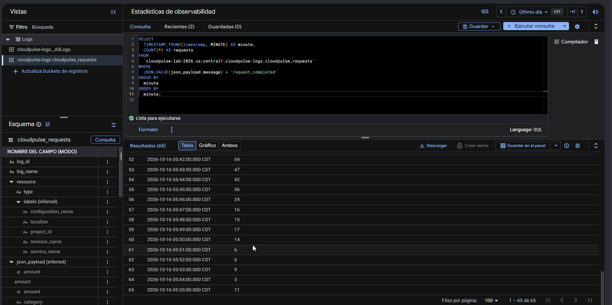

La consulta 1 ejecutada sobre la vista `cloudpulse_requests`, con el resultado
en modo tabla. Los últimos minutos (05:51–05:55 CST, equivalentes a 11:51–11:55
UTC) muestran 6, 6, 9, 3 y 11 solicitudes, idénticos al cálculo sobre el CSV. El
contador «Resultados (65)» es el que motiva el análisis de §7.1.
**Requisito demostrado:** reconstrucción de la curva de tráfico mediante SQL.

### Figura 2 — Solicitudes por outcome

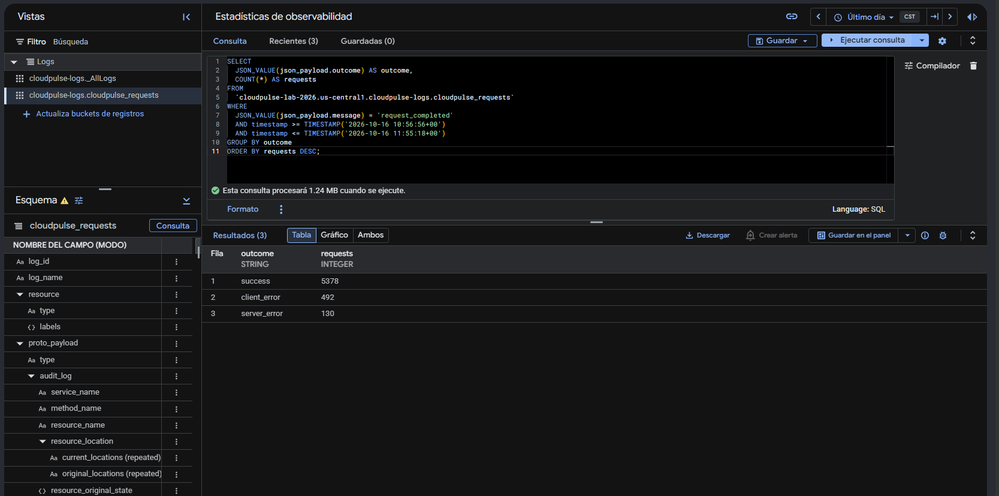

Consulta 2 con ventana temporal explícita. Devuelve `success` 5.378,
`client_error` 492 y `server_error` 130: coincidencia exacta con el CSV. El
panel de esquema de la izquierda muestra `proto_payload.audit_log`, prueba de
que la vista también contiene entradas de auditoría y de que el predicado sobre
`message` es imprescindible.
**Requisito demostrado:** clasificación del resultado de las 6.000 solicitudes.

### Figura 3 — Errores por endpoint

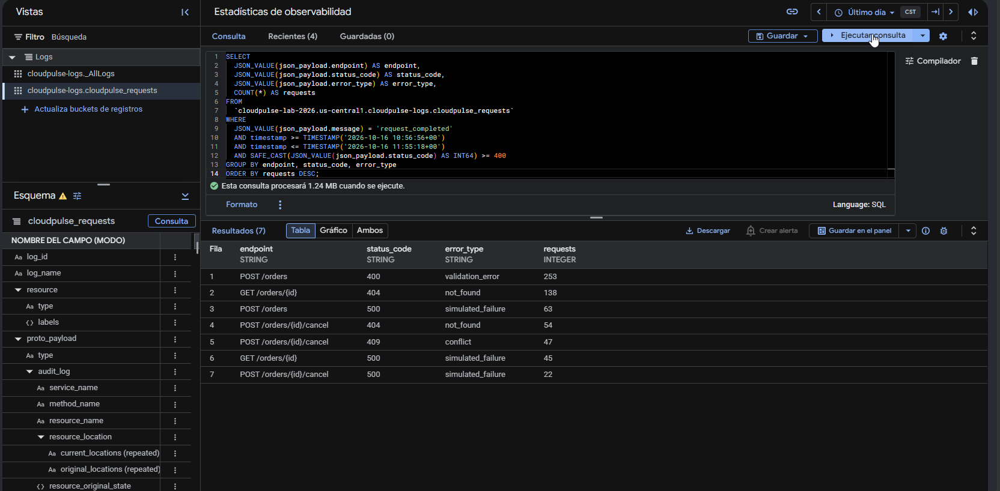

Siete filas que suman 622 errores, desglosadas por ruta plantilla, código y
tipo. Los tres `simulated_failure` suman 130 y **ninguna fila contiene
`unhandled_exception`**.
**Requisito demostrado:** separación entre errores intencionales del cliente
(400/404/409) y fallos internos del servidor (500), sin defectos reales.

### Figura 4 — Media y desviación del minuto de llegada

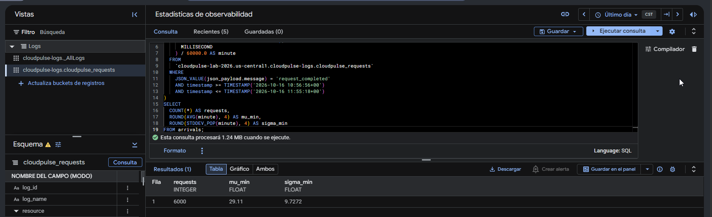

Una sola fila: 6.000 solicitudes, media 29,11 minutos y desviación 9,7272. Las
diferencias con el cálculo automatizado se analizan en §7.2.
**Requisito demostrado:** estimación estadística de la distribución de llegadas
directamente en Log Analytics.

### Figura 5 — Escenario por categoría

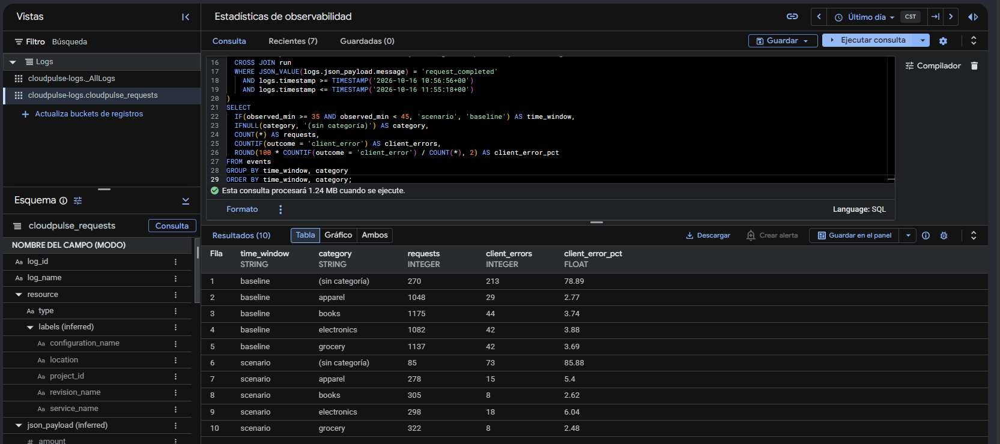

Diez filas que contrastan la ventana del escenario con el resto de la corrida
por categoría. `electronics` dentro de la ventana alcanza el 6,04 % de errores
de cliente frente al 3,88 % fuera. La fila `(sin categoría)` se interpreta en
§7.5.
**Requisito demostrado:** efecto del escenario configurado sobre el segmento
objetivo.

### Figura 6 — Escenario minuto a minuto (consulta corregida)

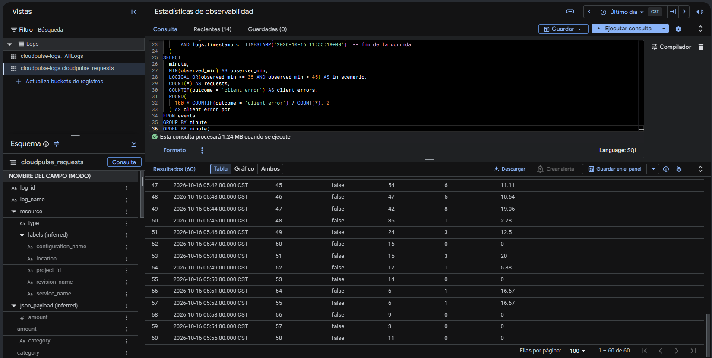

La consulta 5b ya corregida: **«Resultados (60)»** y «1 – 60 de 60», una fila
por minuto de la corrida. En el editor se aprecia la ventana temporal
(`AND logs.timestamp <= TIMESTAMP('2026-10-16 11:55:18+00')`) y el agrupamiento
por minuto con `MIN(observed_min)` y `LOGICAL_OR(...)`, que son las dos
correcciones descritas en §7.3.

Las catorce filas visibles (11:42–11:55 UTC) se verificaron contra los 6.000
eventos de Cloud Logging y coinciden en las cuatro columnas; `observed_min` va
de 45 a 58, lo que confirma que el origen temporal está anclado en el primer
evento de la corrida y no en tráfico anterior.

Como antecedente de depuración, la ejecución previa a la corrección devolvía
119 filas con `in_scenario` en `false` y `observed_min` por encima de 100
(§7.3, etapa 1); esa versión ya no se conserva como figura, pero el diagnóstico
y sus dos causas quedan documentados.

**Requisito demostrado:** evolución de la tasa de error minuto a minuto durante
la corrida, con la ventana del escenario señalada; y, de paso, trazabilidad del
propio proceso de validación.

### Figura 7 — Escenario autocalibrado

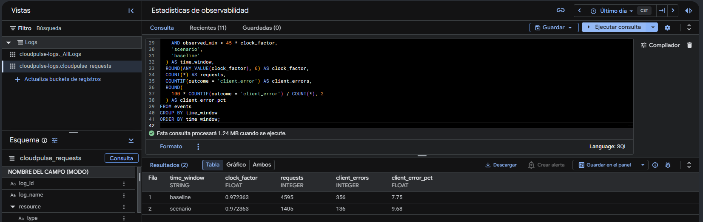

Consulta 5c: `clock_factor` 0,972363, escenario al 9,68 % frente al 7,75 % de
referencia. Es la medición del escenario que no depende ni de la categoría ni
del desvío de reloj.
**Requisito demostrado:** incremento de errores en la ventana configurada,
medido de forma robusta.

### Figura 8 — Trazabilidad por `X-Request-ID`

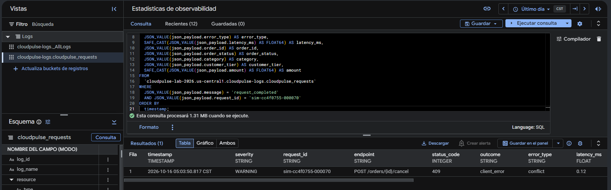

Una única fila para `sim-cc4f0755-000070`: severidad `WARNING`, ruta
`POST /orders/{id}/cancel`, código `409`, `error_type` `conflict`, latencia
interna 0,12 ms. Es la secuencia imposible del laboratorio —cancelar lo ya
cancelado— recuperada desde el identificador que generó el simulador.
**Requisito demostrado:** correlación extremo a extremo mediante
`X-Request-ID`.

### Figura 9 — Dashboard de Cloud Monitoring

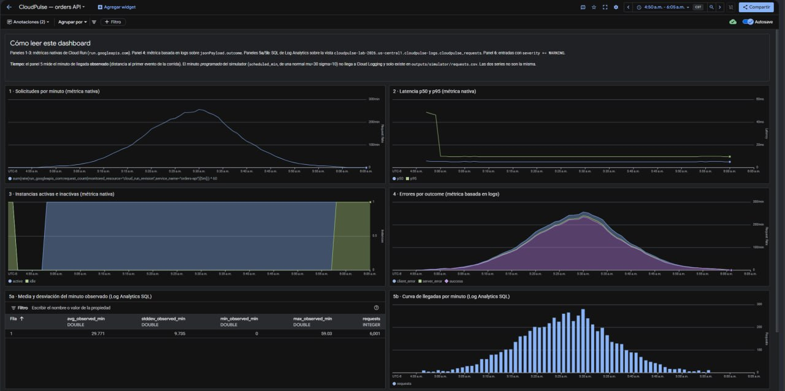

El dashboard unificado: panel de lectura, solicitudes por minuto con la campana
completa, latencia p50/p95 con el pico de arranque en frío, instancias activas
planas en 1, errores por outcome apilados, y los dos paneles de Log Analytics
(media y desviación, e histograma de llegadas). Las cifras del panel 5a se
analizan en §6.5.
**Requisito demostrado:** un único dashboard que combina métricas nativas,
métricas basadas en logs y consultas SQL.

### Figura 10 — Panel de logs `severity >= WARNING`

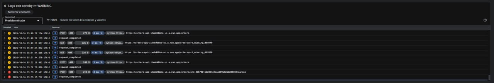

Entradas con severidad igual o superior a `WARNING`: cada rechazo aparece como
la petición de Cloud Run seguida del evento `request_completed` del backend,
en ámbar los `4xx` y en rojo los `5xx`. Las rutas muestran los identificadores
sintéticos `ord_missing_*` de los `404` intencionales.
**Requisito demostrado:** panel de logs integrado en el dashboard, con los
eventos estructurados correlacionables.

## 9. Problemas encontrados y soluciones

### 9.1. Permisos IAM del bucket interno de Cloud Functions

El primer `terraform apply` falló al crear la función:

```text
Access to bucket gcf-v2-sources-199050280954-us-central1 denied.
You must grant Storage Object Viewer permission to orders-api-build@...
```

Cloud Functions de 2.ª generación **no compila desde el bucket del proyecto**:
copia el código a un bucket propio y la compilación lo lee de allí. El permiso
concedido cubría solo el bucket propio. Ese bucket interno únicamente tiene
roles heredados de proyecto, de los que la cuenta de compilación —dedicada y de
mínimo privilegio— no forma parte por diseño.

**Solución:** un `google_storage_bucket_iam_member` adicional que concede
`roles/storage.objectViewer` sobre ese bucket, con el nombre derivado del número
de proyecto en lugar de escrito a mano, y encadenado a la espera de propagación
de IAM para que el permiso exista antes del intento de compilación.

### 9.2. Restricciones del filtro de las Log Views

El filtro de una vista se rechazó dos veces:

1. `jsonPayload.message="request_completed"` → `Invalid view filter`. Los campos
   de payload no son calificadores válidos. Una métrica basada en logs sí los
   acepta; una vista, nunca.
2. `... AND (LOG_ID(stdout) OR LOG_ID(stderr))` → `Filter exceeds the view
   filter nesting depth limit of 1`. La gramática **no admite `OR` en absoluto**:
   el filtro debe ser una conjunción plana, así que cualquier grupo entre
   paréntesis ya excede el anidamiento permitido.

**Solución:** el filtro mínimo verificable, `resource.type="cloud_run_revision"`,
y el predicado sobre el payload trasladado a cada consulta SQL. La decisión se
tomó por modo de fallo: un filtro ruidoso falla de forma visible en SQL,
mientras que un filtro demasiado específico —si el identificador de log fuese
incorrecto— produciría una vista vacía y silenciosa, detectable solo después de
la corrida.

### 9.3. Autenticación de la función privada

El simulador no enviaba credenciales y la función no concede acceso a
`allUsers`, de modo que las 6.000 solicitudes habrían recibido `403`.

**Solución:** presentar un token de identidad en cada solicitud, obtenido con
`gcloud auth print-identity-token`. La cuenta que opera el laboratorio ya tiene
permiso de invocación, **por lo que no hizo falta modificar IAM ni abrir la
función**. El comportamiento se verificó en los dos sentidos: `403` sin token y
`404` con token sobre un pedido inexistente.

### 9.4. Renovación del token durante la corrida

Un token de identidad vive aproximadamente una hora y la corrida dura 60
minutos: un token único habría caducado antes de las últimas solicitudes.

**Solución:** una tarea de fondo que lo renueva cada 30 minutos, de modo que
ningún token se usa más allá de la mitad de su vida. La credencial nunca es
argumento de proceso ni llega al CSV. La evidencia de que funcionó es doble: la
métrica nativa registra **cero respuestas `401` o `403`** en toda la ventana, y
el registro de la corrida no contiene ningún aviso de fallo de renovación.

### 9.5. Desviación temporal del entorno WSL2

La ventana duró **58 min 21 s** en lugar de 60. El desfase entre el instante de
envío y el instante programado crece **linealmente** con el minuto del plan, con
pendiente de −1,6602 s por minuto —un **2,767 %** de desvío—, intercepto 0,196 s
y residuo máximo de 485 ms sobre 3.500 s. El despachador se temporiza con
`CLOCK_MONOTONIC` mientras que la columna `scheduled_at` usa el reloj de pared;
en WSL2 ambos relojes avanzaron a ritmos distintos.

La linealidad casi perfecta descarta congestión, cola o latencia como causas.
**La forma de la distribución se conserva**: los cocientes observado/planificado
son 0,9724 para la media y 0,9723 para la desviación, coincidentes en la cuarta
cifra, de modo que el eje se reescaló sin deformarse.

**Solución adoptada:** no corregir ninguna cifra, documentar el efecto y
proporcionar la consulta 5c, que autocalibra la ventana del escenario a partir
del factor que revela la propia corrida. Para análisis temporal, `sent_at` es la
medición y `scheduled_min` es el plan; `scheduled_at` arrastra el desvío hasta
−99,5 s en las últimas filas.

### 9.6. Diferencias entre métricas nativas, logs y latencias

Tres sistemas miden la misma corrida y ninguno da el mismo número, por razones
legítimas:

| Diferencia | Explicación |
| --- | --- |
| Métrica nativa 6.001 frente a 6.000 filas del CSV | El sondeo de autenticación del preflight |
| `401`/`403` contabilizados por Cloud Run pero ausentes de los logs del backend | La capa de autenticación los rechaza **antes** de ejecutar el contenedor, de modo que no generan evento `request_completed` |
| p50 de 81,2 ms (cliente), 5,06 ms (Cloud Run) y 0,187 ms (función) | Miden tramos distintos del mismo viaje; la diferencia es red, TLS y proxy |
| +36 en la métrica leída con alineación de una hora | Las pruebas previas de las 10:09–10:35, incorporadas por un bucket que empieza antes de la corrida (§7.1) |

La regla práctica que se desprende: **para cifras exactas, los logs; para
tendencias, el dashboard.**

## 10. Seguridad y costos

### 10.1. Superficie de seguridad

| Control | Estado |
| --- | --- |
| Acceso público (`allUsers`) | **Nunca concedido.** El binding existe en Terraform pero desactivado mediante `count = 0` |
| Identidad de ejecución | Cuenta dedicada con **un único rol**: `roles/logging.logWriter` |
| Identidad de compilación | Cuenta dedicada; lectura del código acotada a dos buckets concretos |
| Cuenta por defecto de Compute Engine | **No utilizada** (arrastra `roles/editor`) |
| Roles básicos | Ninguno concedido |
| Credenciales en el repositorio | Ninguna. El token vive solo en memoria y no aparece en CSV, logs ni resúmenes |
| Secretos en los artefactos | Verificado: 0 coincidencias de patrones de credencial |

El experimento se ejecutó contra una **función privada**, autenticando cada
solicitud. La alternativa —abrir la función a `allUsers` durante la corrida—
quedó documentada con su procedimiento de revocación pero **no se utilizó**.

### 10.2. Control de costos

| Control | Valor |
| --- | --- |
| Techo de instancias | `max_instances = 1` |
| Instancias mínimas | 0 (escala a cero entre corridas) |
| Concurrencia | 1 solicitud por instancia |
| Memoria / CPU | 512 MiB / 1 vCPU |
| Timeout | 60 s |
| Retención del bucket de logs | 30 días |
| Ciclo de vida del bucket de código | borrado a los 30 días |

> ⚠️ **El presupuesto de US$5 con alertas no impide cargos.** Google Cloud **no
> suspende** los servicios al alcanzar el importe configurado, y las alertas
> llegan con retraso porque el gasto se evalúa de forma periódica. Es posible
> superar el presupuesto sin que nada lo impida automáticamente. **El único tope
> efectivo son los límites declarados en la función**, no el presupuesto.
>
> Durante este trabajo no se pudo leer el presupuesto configurado por falta de
> permisos sobre la API de `billingbudgets`, de modo que su existencia y su
> importe no están verificados en este informe.

### 10.3. Riesgos de facturación pendientes

| Riesgo | Detalle |
| --- | --- |
| **Recursos vivos** | La función, los dos buckets, el sink, las cuatro métricas y el dashboard siguen existiendo y facturando mientras no se eliminen |
| **Imágenes de Artifact Registry** | Las crea Cloud Build, **no** Terraform, y `terraform destroy` no se las lleva: requieren limpieza manual |
| **Retención de logs** | El bucket conserva los registros 30 días después de la corrida |
| **Vencimiento del crédito gratuito** | Cuando expira el crédito de prueba, los mismos recursos pasan a cobrarse contra la cuenta de facturación. Conviene eliminarlos antes de esa fecha |
| **Doble ingestión** | El sink es aditivo: `_Default` recibe las mismas entradas, de modo que cada una se ingiere dos veces. A este volumen es despreciable |

El procedimiento de limpieza está documentado en `docs/guide.md` §11.
**No se ha ejecutado ninguna limpieza**, a la espera de autorización.

## 11. Conclusiones

### 11.1. Cumplimiento del laboratorio

Los objetivos planteados se cumplieron, con **una excepción y un cumplimiento
parcial**, ambos explícitos:

- **No demostrable (O11):** el escalamiento horizontal no es observable con
  `max_instances = 1`.
- **Cumplimiento parcial (O5b):** la ventana de ejecución se planificó en 60
  minutos, pero la **ejecución observada duró 58 minutos y 21 segundos** por el
  desvío de reloj del 2,767 % (§9.5). El volumen, la forma de la distribución y
  el resto de propiedades del experimento no se vieron afectados: la campana se
  conserva, reescalada de forma uniforme.

El resto de requisitos —tres operaciones, cuatro códigos de error, registros
estructurados, 6.000 solicitudes con distribución normal, errores
intencionales, escenario temporal, correlación por identificador,
infraestructura declarativa con mínimo privilegio, métricas creadas antes del
tráfico, consultas SQL y dashboard unificado— están demostrados con evidencia
verificable.

### 11.2. Calidad de la observabilidad obtenida

La observabilidad construida resiste tres pruebas exigentes:

1. **Completitud.** 6.000 solicitudes producen 6.000 eventos: ni uno perdido, ni
   uno duplicado, con idénticos códigos a ambos lados.
2. **Trazabilidad.** Cualquier solicitud puede seguirse desde su instante
   planificado en el CSV hasta el evento que registró la función, mediante un
   único identificador (figura 8).
3. **Interpretabilidad.** La separación entre errores intencionales del cliente
   y fallos internos del servidor es explícita en el modelo de datos, y permitió
   afirmar con evidencia que los 130 `500` fueron inyectados y que no hubo
   defectos reales.

### 11.3. Limitaciones

| Limitación | Consecuencia |
| --- | --- |
| `max_instances = 1` | No se puede demostrar escalamiento horizontal ni medir el comportamiento del almacén entre instancias |
| Almacén en memoria | El estado no sobrevive al reciclado de la instancia ni se comparte |
| Desvío de reloj del entorno | La ventana real fue de 58 min 21 s; el eje temporal observado está comprimido un 2,767 % |
| Latencia dominada por la red | El 99,8 % de la latencia de cliente ocurre fuera de la función: el experimento mide sobre todo el trayecto de red |
| Filtro de la vista poco selectivo | La vista contiene entradas de auditoría y de sistema, lo que obliga a filtrar en cada consulta |
| Ausencia de *linked dataset* | Las consultas SQL solo pueden ejecutarse desde la consola, no automatizarse |

### 11.4. Mejoras propuestas

1. **Almacenamiento compartido** (Firestore o Memorystore) en lugar del
   diccionario en memoria, para elevar `max_instances` y observar escalamiento
   real sin generar `404` espurios.
2. **Temporizar el despachador contra el reloj de pared**, o medir el desvío
   antes de la corrida, para que la ventana dure exactamente 60 minutos.
3. **Endurecer el filtro de la vista** con `AND LOG_ID("run.googleapis.com/stdout")`,
   ahora que la corrida confirmó empíricamente ese identificador de log.
4. **Crear un *linked dataset* de BigQuery** para automatizar la verificación de
   las consultas SQL y que dejen de depender de la consola.
5. **Registrar cada renovación de token en el momento**, no al final de la
   corrida, para que una ejecución larga sea supervisable en tiempo real.
6. **Añadir la ventana temporal a todas las consultas** del fichero SQL, como se
   hizo tras detectar el defecto de 5b (§7.3).

## 12. Referencias

### Especificación y documentación del proyecto

| Referencia | Contenido |
| --- | --- |
| `AGENTS.md` | Especificación del laboratorio: objetivo, arquitectura, agentes, restricciones y definición de terminado |
| `README.md` | Descripción general, contrato de la API y comandos |
| `docs/guide.md` | Guía de instalación, configuración, despliegue, ejecución y limpieza |
| `docs/architecture.md` | Diagramas de diseño de la función y del evento de log |
| `docs/observability.md` | Diseño de métricas, consultas y dashboard |
| `docs/log-analytics-queries.sql` | Las ocho consultas SQL con sus resultados esperados |
| `outputs/reports/official-run-report.md` | Informe automatizado de la corrida oficial |
| `outputs/reports/log-analytics-validation.md` | Auditoría de las consultas y checklist de evidencias |
| `outputs/reports/predeployment-review.md` | Auditoría previa al despliegue |
| `outputs/simulator/requests.csv` | Registro primario: 6.000 filas, 20 columnas |

### Documentación técnica consultada

| Fuente | Uso |
| --- | --- |
| Cloud Logging — `projects.locations.buckets.views` (referencia REST, campo `filter`) | Gramática del filtro de las Log Views (§9.2) |
| Cloud Logging — Log views | Campos admitidos y operadores |
| Cloud Run — Logging | Tipos de recurso y nombres de log |
| Terraform — proveedor `hashicorp/google`, recurso `google_cloudfunctions2_function` | Esquema de la función de 2.ª generación y cuenta de compilación propia |
| Terraform — `google_logging_project_sink`, campo `unique_writer_identity` | Valor por defecto y semántica de actualización |
| Cloud Storage — Infraestructura como código | Acceso uniforme y prevención de acceso público |
| Skills locales `cloud-run-basics`, `cloud-logging-configuration-basics`, `iam-helper-for-policy-management`, `gcloud` | Guías operativas y guardarraíles aplicados durante el trabajo |

---

**Estado final:** laboratorio completado y documentado. No se ha ejecutado
limpieza de recursos.
